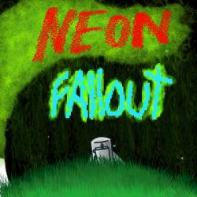

# OpenGameArt: music

**38 assets from [OpenGameArt](https://opengameart.org), dedicated to the public domain under [CC0](https://creativecommons.org/publicdomain/zero/1.0/).** Use them in any game, free or paid, and change them however you like; no credit is needed.

Music from OpenGameArt entries licensed CC0 (some also offer other licences; CC0 is the one that applies here). 831.5 MB in all.

This is a copy kept by [zuujis-cc0](https://github.com/zuujis-cc0) so game makers can take single files from GitHub. It is not made by or affiliated with OpenGameArt: the originals, often in more formats and higher resolutions, are on [opengameart.org](https://opengameart.org). If they help you, consider [supporting OpenGameArt](https://opengameart.org/content/faq).

Every file is listed in [MANIFEST.tsv](MANIFEST.tsv) with its size and SHA-256. More free assets: [the Zuujis collection](https://github.com/zuujis-cc0/free-game-assets#readme).

| | | | |
| :-: | :-: | :-: | :-: |
| <b><a href="bravery-vampire">Bravery Vampire</a></b> by MintoDog · <a href="https://opengameart.org/content/bravery-vampire">source</a> | <b><a href="breakhigh">Breakhigh</a></b> by Cloudychaos · <a href="https://opengameart.org/content/breakhigh">source</a> | <b><a href="breathe-in">Breathe In</a></b> by SkyleTheFrench · <a href="https://opengameart.org/content/breathe-in">source</a> | <b><a href="c64-oricana-style-5">C64 Oricana Style 5</a></b> by Tozan · <a href="https://opengameart.org/content/c64-oricana-style-5">source</a> |
| <b><a href="c64-orient-style-2">C64 Orient Style 2</a></b> by Tozan · <a href="https://opengameart.org/content/c64-orient-style-2">source</a> | <b><a href="c64-rythym-track-1-oricana">C64 Rythym Track 1 Oricana</a></b> by Tozan · <a href="https://opengameart.org/content/c64-rythym-track-1-oricana">source</a> | <b><a href="call-to-battle">Call to Battle</a></b> by Eldritch Grim · <a href="https://opengameart.org/content/call-to-battle">source</a> | <b><a href="calm-fireplace-guitar-song">Calm fireplace guitar song</a></b> by ShggothSlave · <a href="https://opengameart.org/content/calm-fireplace-guitar-song">source</a> |
| <b><a href="calm-theme">calm theme</a></b> by pebonius · <a href="https://opengameart.org/content/calm-theme">source</a> | <b><a href="canary">Canary</a></b> by hatmix · <a href="https://opengameart.org/content/canary">source</a> | <b><a href="caper">Caper</a></b> by Pro Sensory · <a href="https://opengameart.org/content/caper">source</a> | <b><a href="carnage-boss-battle-centurion-of-war-vs-nene">Carnage & Boss battle (Centurion of war vs nene)</a></b> by glitchart · <a href="https://opengameart.org/content/carnage-boss-battle-centurion-of-war-vs-nene">source</a> |
| <b><a href="catacombs-chanting-loop">Catacombs Chanting Loop</a></b> by beardalaxy · <a href="https://opengameart.org/content/catacombs-chanting-loop">source</a> | <b><a href="caves-collection">Caves (Collection)</a></b> by Holizna · <a href="https://opengameart.org/content/caves-collection">source</a> | <b><a href="celestial-harmony">Celestial Harmony</a></b> by vitalezzz · <a href="https://opengameart.org/content/celestial-harmony">source</a> | <b><a href="central-brocessing-unit">Central Brocessing Unit</a></b> by Chance de la Soul · <a href="https://opengameart.org/content/central-brocessing-unit">source</a> |
| <b><a href="centurion-of-war-vs-pixelsphere-pushing-ahead-the-hex-the-charm-remixed">Centurion of war Vs Pixelsphere (Pushing ahead, the hex, the charm remixed)</a></b> by glitchart · <a href="https://opengameart.org/content/centurion-of-war-vs-pixelsphere-pushing-ahead-the-hex-the-charm-remixed">source</a> | <b><a href="chains-of-discord">Chains of Discord</a></b> by Mouseborg · <a href="https://opengameart.org/content/chains-of-discord">source</a> | <b><a href="character-selection-theme-loop">Character Selection Theme Loop</a></b> by beardalaxy · <a href="https://opengameart.org/content/character-selection-theme-loop">source</a> | <b><a href="chase-2">Chase</a></b> by Adiutorium · <a href="https://opengameart.org/content/chase-2">source</a> |
| <b><a href="chasing-memories">Chasing Memories</a></b> by vitalezzz · <a href="https://opengameart.org/content/chasing-memories">source</a> | <b><a href="chasing-the-leviathan-adventure-world-music-album">Chasing the Leviathan [ Adventure / World Music album ]</a></b> by jomusic · <a href="https://opengameart.org/content/chasing-the-leviathan-adventure-world-music-album">source</a> | <b><a href="chave-music-for-a-game">CHAVE MUSIC FOR A GAME</a></b> by KTK · <a href="https://opengameart.org/content/chave-music-for-a-game">source</a> | <b><a href="cheerful-christmas-time">Cheerful Christmas Time</a></b> by Tarush Singhal · <a href="https://opengameart.org/content/cheerful-christmas-time">source</a> |
| <b><a href="cherry-5">Cherry 5</a></b> by Tozan · <a href="https://opengameart.org/content/cherry-5">source</a> | <b><a href="cherry-6">Cherry 6</a></b> by Tozan · <a href="https://opengameart.org/content/cherry-6">source</a> | <b><a href="chiesek-trading-outpost-starmap-vendor-store">Chiesek Trading Outpost Starmap Vendor Store</a></b> by Tozan · <a href="https://opengameart.org/content/chiesek-trading-outpost-starmap-vendor-store">source</a> | <b><a href="childlike-wonder">Childlike wonder</a></b> by Tarush Singhal · <a href="https://opengameart.org/content/childlike-wonder">source</a> |
| <b><a href="chill-beats-collection">Chill Beats (Collection)</a></b> by Holizna · <a href="https://opengameart.org/content/chill-beats-collection">source</a> | <b><a href="chill-chiptunes-collection">Chill Chiptunes (Collection)</a></b> by Holizna · <a href="https://opengameart.org/content/chill-chiptunes-collection">source</a> | <b><a href="chillout-instrumentals-collection">Chillout Instrumentals (Collection)</a></b> by Holizna · <a href="https://opengameart.org/content/chillout-instrumentals-collection">source</a> | <b><a href="chills">Chills</a></b> by Holizna · <a href="https://opengameart.org/content/chills">source</a> |
| <b><a href="chiploop">Chiploop</a></b> by iamoneabe · <a href="https://opengameart.org/content/chiploop">source</a> | <b><a href="chiptune-chops">Chiptune Chops</a></b> by Eldritch Grim · <a href="https://opengameart.org/content/chiptune-chops">source</a> |  <b><a href="chiptune-stars">ChipTune Stars</a></b> by Hazmat Harry · <a href="https://opengameart.org/content/chiptune-stars">source</a> | <b><a href="chord-tune-2">Chord Tune 2</a></b> by Tozan · <a href="https://opengameart.org/content/chord-tune-2">source</a> |
| <b><a href="chord-tune-3">Chord Tune 3</a></b> by Tozan · <a href="https://opengameart.org/content/chord-tune-3">source</a> | <b><a href="circuit-veil">circuit veil</a></b> by cinameng · <a href="https://opengameart.org/content/circuit-veil">source</a> |  |  |

---

Kept up to date by this repository's own [update workflow](.github/workflows/update.yml), with code and plan from [cc0-mirror](https://github.com/zuujis-cc0/cc0-mirror). Something wrong? [Open an issue there](https://github.com/zuujis-cc0/cc0-mirror/issues/new) or use the [private report form](https://games.zuujis.com/report).
